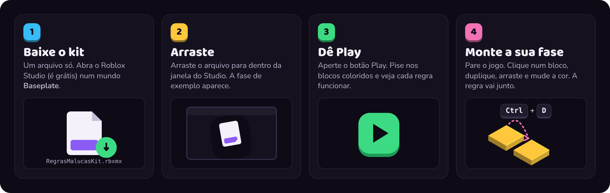

# Regras Malucas para pais (versão fácil)

**Você não precisa saber programar.** Em 10 minutos você e seu filho(a) colocam no Roblox Studio uma
fase com trampolim, teleporte, gravidade leve e outras 6 regras malucas, e depois montam a fase de vocês
só copiando e arrastando blocos.

  

## O que você precisa

- Um computador (Windows ou Mac). Tablet e celular não abrem o Roblox Studio.
- O **Roblox Studio**, gratuito, em [create.roblox.com](https://create.roblox.com).
- Uma conta Roblox. Pode ser a sua; se for a da criança, confira os controles parentais na central de ajuda oficial do Roblox.

## Passo a passo

**1. Baixe o kit.** Clique no botão verde acima. Vem um arquivo chamado `RegrasMalucasKit.rbxmx`.

**2. Abra um mundo vazio.** No Roblox Studio, clique em **Baseplate** (o chão cinza). Ele abre um mundo
com um chão e um ponto de nascimento.

**3. Arraste o arquivo** da pasta Downloads para dentro da janela do Studio.
A fase de exemplo aparece: 9 blocos coloridos com o nome de cada regra flutuando em cima.

> Não deu certo arrastar? No painel **Explorer** (à direita), clique com o botão direito em
> **Workspace** → **Insert from File...** e escolha o arquivo.

**4. Dê Play.** Clique no botão **Play** no topo (ou aperte **F5**). Ande até os blocos e pise em cada um.
Para parar, clique em **Stop** (ou **Shift + F5**).

**5. Monte a sua fase.** Com o jogo parado:
- Clique num bloco e aperte **Ctrl + D** (no Mac, **Cmd + D**) para fazer uma cópia. **A regra vai junto.**
- Use a ferramenta **Move** (aba Home) para arrastar a cópia para onde quiser.
- Mude a cor e o tamanho em **Properties**. A regra continua funcionando.

Dê Play de novo e teste. Pronto: vocês estão criando um jogo.

## O que cada bloco faz

| Bloco | O que acontece |
|---|---|
| 🟨 Trampolim | Joga você para o alto |
| 🟦 Velocidade | Você corre muito rápido por 5 segundos |
| 🟪 Gravidade Leve | Você fica leve e pula longe por 5 segundos |
| 🟩 Cura | Enche a vida |
| 🟧 Dano | Tira um pouco de vida |
| 🟥 Morte | Volta para o começo (cuidado!) |
| 🌸 Some Ao Tocar | O bloco some depois que você pisa e volta depois |
| 💛 Pisca-Pisca | O bloco aparece e some sozinho |
| 🩵 Teleporte | Leva você para o alto da torre |

## Ideias para brincar juntos

1. **Corrida de obstáculos:** copiem blocos de Pisca-Pisca e Some Ao Tocar em fila, com o chão de Morte embaixo.
2. **Trampolim em escada:** coloquem um Trampolim e, mais alto, uma plataforma. Quantos pulos até o topo?
3. **Cada um faz uma fase:** um monta, o outro testa. Quem testa conta o que achou difícil e o que achou divertido.
4. **Desafio extra:** clique no Trampolim, vá em **Properties → Attributes → +**, crie um atributo
   `Forca` do tipo **Number** e coloque `250`. O pulo fica muito mais alto. (Sem o atributo, a força é 120.)

Deixe a criança no mouse e no teclado. Seu papel é perguntar: *"o que você acha que vai acontecer?"*

## Deu problema?

| O que aconteceu | O que fazer |
|---|---|
| Os blocos não fazem nada | Confira se você deu **Play**. Não funciona com o jogo parado. |
| Tudo acontece duas vezes | O kit foi arrastado duas vezes. No Explorer, apague uma das pastas `RegrasMalucasKit`. |
| Não acho a fase | No Explorer, abra `RegrasMalucasKit` → `Fase de exemplo`, clique num bloco e aperte **F** para a câmera ir até ele. |
| Apaguei sem querer | **Ctrl + Z** desfaz. |

## Este arquivo é seguro?

Sim. Todo o código está aberto aqui no GitHub, e o arquivo **não baixa nada da internet** nem usa
códigos escondidos. Ele só tem os blocos de exemplo e as regras.

Fica a dica para outros modelos: na **Toolbox** do Studio existem modelos com scripts escondidos que
fazem coisas que você não quer. Prefira materiais de quem mostra o código, como este.

## Quer ir além?

- 📘 O livro **Crie o primeiro obby com seu filho(a)** ensina, em 9 sessões, a criança a escrever
  essas regras ela mesma. [Entre na lista de espera →](https://paulapeclat.github.io/primeiro-obby/)
- Se você já programa, o [README](README.md) explica como o kit funciona por dentro.

## Palavras que aparecem no Studio

| No Studio | Quer dizer |
|---|---|
| Part | Um bloco |
| Tag | Uma etiqueta no bloco. A etiqueta `Regra:Trampolim` é o que faz o bloco virar trampolim |
| Attribute | Um ajuste do bloco, como a força do pulo |
| Script | Instruções em código. O kit já vem com elas, você não precisa abrir |
| Explorer | A lista de tudo que existe no mundo |
| Properties | As características do bloco selecionado: cor, tamanho, material |

---

Feito por **Paula Peclat**, pedagoga e game developer · [paulapeclat.com.br](https://paulapeclat.com.br) ·
Projeto independente, não afiliado à Roblox Corporation.
