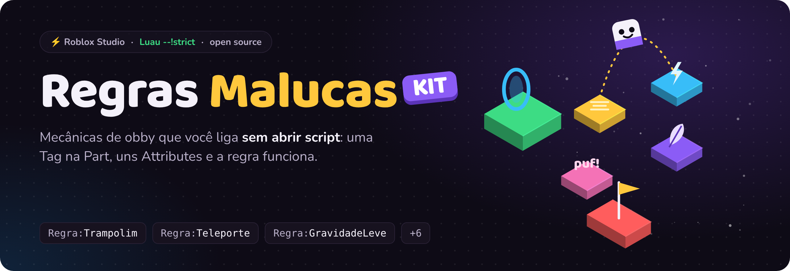
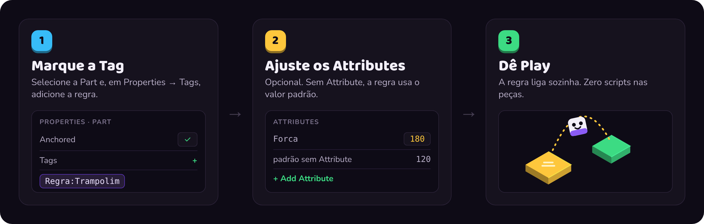
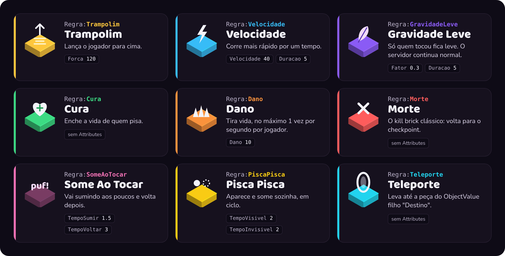

<p align="center">
  
</p>

<p align="center">
  
  
  
  <a href="https://github.com/paulapeclat/regras-malucas-kit/actions"></a>
</p>

<p align="center">
  <b>9 regras de obby prontas.</b> Marque uma Part com uma Tag, ajuste os Attributes e dê Play.<br>
  <sub>🇬🇧 Tag-driven obby mechanics for Roblox. Tag a Part, tweak its Attributes, done.</sub>
</p>

<p align="center">
  <a href="#-como-funciona">Como funciona</a> ·
  <a href="#-as-regras">As regras</a> ·
  <a href="#-instalação">Instalação</a> ·
  <a href="#-crie-a-sua-regra">Crie a sua</a> ·
  <a href="#-o-livro">O livro</a>
</p>

---

## 🧩 Como funciona



Um único Script liga tudo:

```lua
-- ServerScriptService/IniciarRegras (Script)
local Kit = require(game.ServerScriptService.RegrasMalucasKit)
Kit.iniciar()
```

A partir daí, quem monta a fase **não abre nenhum script**: basta colocar Tags e Attributes nas peças.
Isso também vale para peças criadas durante o jogo.

## 🎮 As regras



<details>
<summary><b>Tabela das Tags e Attributes (texto)</b></summary>

| Tag | O que faz | Attributes (padrão) |
|---|---|---|
| `Regra:Trampolim` | Lança o jogador para cima | `Forca` (120) |
| `Regra:Velocidade` | Corre mais rápido por um tempo | `Velocidade` (40), `Duracao` (5) |
| `Regra:GravidadeLeve` | Só quem tocou fica leve | `Fator` (0.3), `Duracao` (5) |
| `Regra:Cura` | Enche a vida | – |
| `Regra:Dano` | Tira vida, 1×/s por jogador | `Dano` (10) |
| `Regra:Morte` | Kill brick | – |
| `Regra:SomeAoTocar` | Some aos poucos e volta | `TempoSumir` (1.5), `TempoVoltar` (3) |
| `Regra:PiscaPisca` | Aparece e some em ciclo | `TempoVisivel` (2), `TempoInvisivel` (2) |
| `Regra:Teleporte` | Leva até a peça do `ObjectValue` filho `Destino` | – |

Uma Part pode ter várias Tags ao mesmo tempo (ex.: `Regra:SomeAoTocar` + `Regra:Dano`).
</details>

## 🐛 Por que existe

As primeiras versões destas regras eram um script por peça, copiado e colado. Isso gerava quatro
problemas recorrentes, que o kit resolve por design:

| No script copiado | No kit |
|---|---|
| Um toque dispara a regra dezenas de vezes (o `Touched` repete enquanto o pé encosta) | `Cooldown` **por jogador**, que não bloqueia os outros |
| Pisar duas vezes no bônus guardava o valor já aumentado, e o bônus ficava para sempre | `Util.propriedadeTemporaria` guarda o valor **original** só no primeiro efeito |
| `workspace.Gravity = 10` deixava **o servidor inteiro** leve | `GravidadeLeve` aplica uma `VectorForce` só em quem tocou |
| 40 cópias do mesmo script para manter | Um módulo; as peças só têm Tags e Attributes |

## 📦 Instalação

| Jeito | Como |
|---|---|
| **Rojo** (recomendado) | Copie a pasta `src` para o seu projeto e mapeie como `RegrasMalucasKit` no `ServerScriptService` |
| **Wally** | `RegrasMalucasKit = "paulapeclat/regras-malucas-kit@0.1.0"` em `[server-dependencies]` |
| **Só o Studio** | Crie um ModuleScript `RegrasMalucasKit` com o conteúdo de `src/init.luau` e, dentro dele, os ModuleScripts `Regras`, `Util` e `Cooldown` |

## ✨ Crie a sua regra

Uma regra é só uma função que recebe a Part. Registre antes de `iniciar()` e use a Tag `Regra:<Nome>`:

```lua
local Kit = require(game.ServerScriptService.RegrasMalucasKit)

Kit.Regras.Gigante = function(parte: BasePart)
	parte.Touched:Connect(function(hit)
		-- sua regra aqui; veja src/Regras.luau como modelo
	end)
end

Kit.iniciar()
```

## 🛠️ Por dentro

- `--!strict` em todos os módulos.
- Toda a lógica roda no **servidor**: o cliente não decide dano, cura nem teleporte.
- `Cooldown` não depende do Roblox (recebe o relógio por parâmetro), por isso tem testes em Luau puro.
- Tabelas internas com `__mode = "k"`, para não segurar na memória peças e Humanoids destruídos.
- CI no GitHub Actions: StyLua, Selene e testes a cada push.

```bash
rokit install                       # rojo, stylua, selene
rojo serve demo.project.json        # place de teste
stylua --check src tests examples
selene src examples
luau tests/Cooldown.spec.luau       # testes, rodam fora do Roblox
```

## 📘 O livro

<table>
<tr>
<td>

**Crie o primeiro obby com seu filho(a)**

Um passo a passo para pais e crianças construírem juntos o primeiro jogo, em 9 sessões:
a criança no teclado, você no code review. As regras deste kit aparecem lá explicadas do zero.

<a href="https://paulapeclat.github.io/primeiro-obby/"></a>

</td>
</tr>
</table>

---

<p align="center">
  Feito por <b>Paula Peclat</b>, pedagoga e game developer · <a href="https://paulapeclat.com.br">paulapeclat.com.br</a><br>
  <sub>Licença MIT · Projeto independente, não afiliado à Roblox Corporation.</sub>
</p>
